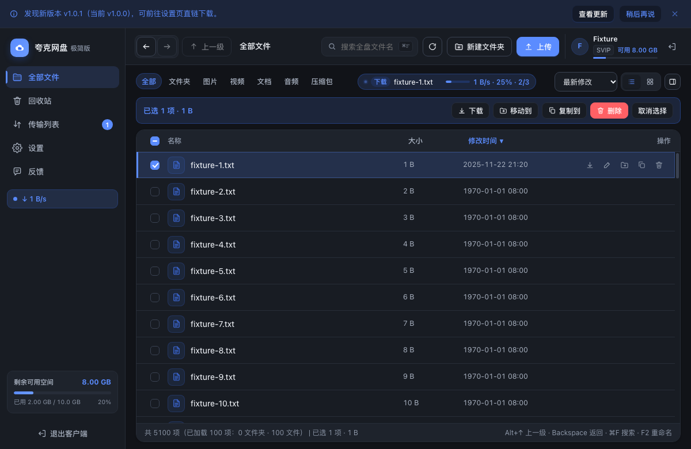
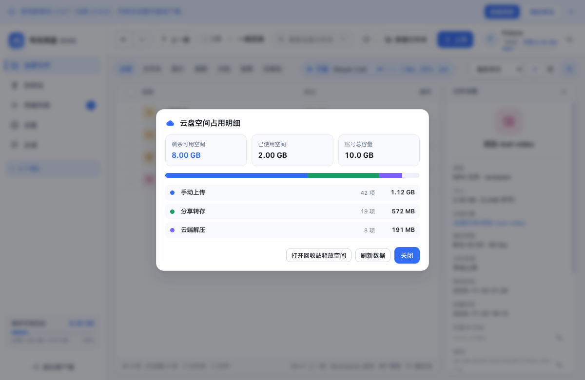

<div align="center">


# 夸克网盘极简版 · Quark Drive Lite

**轻巧、纯粹、高速的开源夸克网盘桌面客户端**  
基于 **Tauri 2 + Rust** 原生内核打造 · **极致轻量体积** · 零广告 · 零后台常驻 · 隐私优先

[](https://github.com/xiaodianshiuwu/quark-drive-lite/releases/latest)
[](https://github.com/xiaodianshiuwu/quark-drive-lite/releases/latest)
[](#核心架构与隐私承诺)
[](#核心架构与隐私承诺)
[](#-交流群与反馈)
[](LICENSE)

[**立即下载最新版 v1.3.6**](https://github.com/xiaodianshiuwu/quark-drive-lite/releases/latest) · [**30 秒上手**](#-30-秒快速上手) · [**界面预览**](#-界面预览) · [**交流群**](#-交流群与反馈) · [**完整更新日志**](CHANGELOG.md)

</div>

---

> ### 🎉 v1.3.6 正式发布 · 传输引擎全面提速 · 可选桌面悬浮球与云解压悬浮窗 · 全平台安装包再度瘦身
> **强烈建议所有旧版本用户直接更新至最新正式版 `v1.3.6`**！（历史旧版本仅作为静态存档保留，已去除一切云服务器关联。）  
>
> 本次 **v1.3.6** 聚焦真实传输性能、高频交互痛点与桌面轻量化体验：
> - **自研传输引擎深度重构提速**：启用 HTTP/1.1 独立下载通道、智能自适应并发爬坡、多任务连接预算、15 秒卡死自愈重启、慢节点自动切链，以及上传读盘与鉴权重叠并行；实测多任务与复杂网络下显著提速且内存更低。
> - **两款可选桌面置顶悬浮窗（默认关闭，不占额外资源）**：全新「极简下载/上传速率悬浮球」与「云解压进度悬浮窗」，最小化主窗口也能实时掌握进度并一键切回。
> - **大目录全量全选**：文件夹包含大量小文件跨越多页时，点击全选会自动加载剩余分页并选中整个目录的全部项目，不再漏选。
> - **视觉与细节全面打磨**：修复文件/文件夹勾选框对勾偏移、修复深色模式下文件夹图标反色问题、优化列表渲染性能、进一步精简优化中文报错提示，并新增项目 QQ 交流群（自愿加入）。
> - **全平台安装包再度瘦身**：结合 Fat LTO、`panic = "abort"`、Windows NSIS LZMA 压缩与便携版最高压缩等级，进一步压低安装与下载体积。

---

## ✨ 核心特性一览

官方客户端体积庞大、常驻多进程与广告推广；**夸克网盘极简版**用原生 Rust 内核专注做好文件浏览、高速并发传输与高频云工具：

| 维度 | 夸克网盘极简版 v1.3.6 |
|---|---|
| **极致轻量与低占用** | **Tauri 2 + Rust** 原生编译（Fat LTO + `panic = "abort"` + 原生 TLS + NSIS LZMA），全平台安装包仅 **~3–5 MB**，复用系统 WebView，启动快、低内存、退出即彻底释放无后台驻留 |
| **自研高速传输引擎** | HTTP/1.1 独立下载通道 + **智能自适应并发爬坡与全局连接预算**（避免多任务争抢降速）+ **15 秒卡死自愈重启与慢节点自动切换** + **≤8 MiB 小文件直下快车道** + **大文件 4 MiB 缓冲与按需并行哈希**；流式并发分片上传（**读盘与鉴权重叠并行** + 复用哈希 + 秒传）；支持整个文件夹及子目录递归批量下载与断点续传 |
| **可选桌面置顶悬浮窗** | 设置中可按需开启（**默认关闭、零额外内存**）：① **极简传输悬浮球**（实时显示上传/下载速率与任务数，点击一键回到传输页）；② **云解压悬浮窗**（独立置顶追踪在线解压进度） |
| **丝滑文件工作台** | **大目录跨分页一键全量全选**、底部零跳动悬浮批量操作胶囊（选行 0px 位移，单选压缩包一键直达「云解压」）、深层目录面包屑（`···` 跳级 + 滚轮/侧键前进后退）、文件夹真实大小自动回填、深浅双主题高对比度图标、列表/网格双视图虚拟滚动 |
| **五大极简云工具** | **压缩包云解压与在线浏览**（支持目录钻取 / 密码解锁 / 勾选部分解压 / 同名覆盖确认 / 可选独立悬浮窗）、**增强文件详情 & 历史版本恢复**、**云盘空间占用分类明细**、**轻量回收站**、**顶栏与侧栏剩余空间实时直显** |
| **清晰中文提示与安全边界** | 前端报错全面转为通俗易懂的中文原因与建议，底层日志保留完整结构化错误码与状态码；严格 CSP、最小权限窗口白名单、本地 AES-256-GCM 加密凭据、无任何报毒风险加壳手段 |

---

## 💬 交流群与反馈

- **夸克网盘项目交流群（QQ 群）**：**`1054152586`**（完全自愿加入，欢迎反馈使用问题、交流传输体验或提出新功能想法，一起把项目打磨得更好）
- **GitHub Issues**：[提交 Bug 或功能建议](https://github.com/xiaodianshiuwu/quark-drive-lite/issues)
- **客户端快捷复制**：应用内 `设置 → 社区与交流` 可一键复制群号。

---

## 📸 界面预览

### 浅色 / 深色双主题 · 文件夹真实大小自动统计 + 详情侧栏 + 实时传输胶囊

<table>
  <tr>
    <td width="50%">
      
      <div align="center"><sub>浅色工作台 · 文件夹真实大小自动回填 & 右侧增强详情</sub></div>
    </td>
    <td width="50%">
      
      <div align="center"><sub>深色工作台 · 高对比度文件夹图标 & 实时传输胶囊</sub></div>
    </td>
  </tr>
</table>

### 极简云工具 · 云解压 / 空间占用明细 / 回收站 / 新手引导

<table>
  <tr>
    <td width="50%">
      
      <div align="center"><sub>压缩包云解压 · 支持底部悬浮栏一键打开与可选独立悬浮窗</sub></div>
    </td>
    <td width="50%">
      
      <div align="center"><sub>空间占用明细 · 点击左下角空间卡片一键查看分类占比</sub></div>
    </td>
  </tr>
  <tr>
    <td width="50%">
      
      <div align="center"><sub>轻量回收站 · 原路径与剩余保留天数一目了然</sub></div>
    </td>
    <td width="50%">
      
      <div align="center"><sub>新手引导教程 · 4 步快速上手，支持随时「全部跳过」</sub></div>
    </td>
  </tr>
</table>

---

## 🚀 30 秒快速上手

### 1. 下载安装（推荐直接下载最新正式版）

前往 [**GitHub Releases（最新版）**](https://github.com/xiaodianshiuwu/quark-drive-lite/releases/latest) 选择对应系统安装包：

| 平台 | 安装包文件 | 说明 |
|---|---|---|
| **Windows 10 / 11 (x64)** | `QuarkDriveLite-1.3.6-Windows-x64-Setup.exe` | **安装版**（NSIS LZMA 轻量压缩，支持简中/英文、当前用户免管理员安装、干净卸载） |
| **Windows 10 / 11 (x64)** | `QuarkDriveLite-1.3.6-Windows-x64-Portable.zip` | **便携版**（UTF-8 编码兼容，解压即运行） |
| **macOS Apple Silicon (arm64)** | `QuarkDriveLite-1.3.6-macOS-arm64.dmg` / `.zip` | M 系列 Mac，安装或解压拖入「应用程序」即可使用 |
| **macOS Intel (x64)** | `QuarkDriveLite-1.3.6-macOS-x64.zip` | Intel 芯片 Mac，解压后拖入「应用程序」即可使用 |
| **Linux x64（Debian / Ubuntu）** | `QuarkDriveLite-1.3.6-Linux-x64.deb` | 运行 `sudo apt install ./QuarkDriveLite-1.3.6-Linux-x64.deb` 安装 |
| **Linux x64（通用便携版）** | `QuarkDriveLite-1.3.6-Linux-x64.AppImage` | 运行 `chmod +x QuarkDriveLite-1.3.6-Linux-x64.AppImage` 后直接运行 |

> 💡 **安装与版本说明**：
> - **版本建议**：历史旧版本 Releases 仅用于存档，已去除与作者云服务器的一切关联；**强烈推荐所有用户直接下载并使用最新正式版 `v1.3.6`**。
> - **完整性校验**：所有发行包均附带 `SHA256SUMS.txt` 供核验；官方正式版内建的可选在线更新支持 Ed25519 数字签名 + SHA-256 双重校验。
> - **Linux 依赖**：详见 [平台支持文档](docs/PLATFORM_SUPPORT.md)。
> - **macOS 首次启动提示**：开源未签名构建若提示「无法验证开发者」，在终端执行一次即可：
>   ```sh
>   xattr -dr com.apple.quarantine "/Applications/QuarkDriveLite.app"
>   ```

### 2. 日常高效使用

1. **登录夸克账号**：点击右上角「登录」，在独立原生窗口完成扫码或账号登录（凭证通过 AES-256-GCM 加密保存在本机独立资料目录）。
2. **文件与目录操作**：
   - **双击**文件夹秒进、**双击**文件直接下载；大目录点击表头「全选」或 `Ctrl/⌘ + A` 会自动拉取未加载分页并选中全部项目；
   - **单选压缩包**后底部悬浮栏直接出现「**云解压**」按钮，右键同样支持「下载到指定位置…」「下载文件夹」「云解压 / 浏览内容…」；
   - **拖拽**本地文件到窗口即可直接上传至当前目录。
3. **按需开启桌面悬浮窗**：在 `设置 → 界面与悬浮窗` 中可独立开关「极简下载/上传悬浮球」和「云解压悬浮窗」（均默认关闭）。

---

## ⌨️ 常用快捷键

| 快捷键 | 功能 |
|---|---|
| `Alt + ↑` / `Backspace` | 返回上一级目录（或退出搜索返回原目录） |
| `Alt + ←` / `Alt + →` / 鼠标侧键 | 目录浏览历史后退 / 前进 |
| `Ctrl + F`（macOS: `⌘ + F`） | 聚焦全盘文件搜索 |
| `Ctrl + I`（macOS: `⌘ + I`） | 开关右侧文件详情抽屉 |
| `Ctrl + Shift + N`（macOS: `⌘ + ⇧ + N`） | 在当前目录新建文件夹 |
| `F2` | 重命名当前选中文件/文件夹 |
| `Enter` | 打开选中文件夹 / 下载选中文件 |
| `Ctrl + A`（macOS: `⌘ + A`） | 全选当前目录（大目录自动加载全部分页） |
| `Esc` | 取消当前选中 / 关闭弹窗 |
| `Delete`（macOS: `⌘ + Backspace`） | 删除选中项目至回收站 |
| `F5` / `Ctrl + R`（`⌘ + R`） | 刷新当前目录与剩余空间 |

---

## 🛡️ 核心架构、开源范围与隐私承诺

- **本地加密、直连夸克官方接口**：登录 Cookie 使用 **QCK2 AES-256-GCM** 加密保存于本机独立资料目录（不注入前端页面），所有网盘文件操作均由 Rust 内核直连夸克官方 HTTPS 接口，无中转代理、不绕过官方权益规则。
- **MIT 开源边界清晰**：本公开仓库完整开源客户端主体、Rust 网盘核心、自研并发传输引擎、桌面界面、云工具与 AI 实验室模块（MIT 协议）；与作者自有服务器直连的在线更新/反馈接入模块及服务端代码不纳入公开仓库，自行从源码编译的版本为纯粹本地离线模式，零第三方远端连接。
- **官方正式版可选服务默认关闭**：官方发布的预编译安装包提供可选的在线更新、通知公告、意见反馈与零 PII 性能诊断通道，**默认关闭、拒绝即严格零外传**；开启后仅上报纯数值与枚举型性能指标，**绝不采集任何文件名、本地路径、FID、直链、Cookie、Token、账号或 IP**。
- **AI 实验室（Beta · 默认关闭）**：内置对话与 MCP / Agent 本地网关默认隐藏且不启动，需在 `设置 → AI 实验室` 手动开启，默认只读且严格受目录白名单约束。
- **独立资料目录**：
  - macOS：`~/Library/Application Support/cn.quarkdrive.lite.tauri`
  - Windows：`%APPDATA%\cn.quarkdrive.lite.tauri`
  - Linux：`$XDG_DATA_HOME/cn.quarkdrive.lite.tauri`（默认 `~/.local/share/cn.quarkdrive.lite.tauri`）

---

## 🛠️ 从源码构建与自动化验证

环境要求：**Rust stable**、**Node.js ≥ 24** 及对应平台的 [Tauri 2 构建依赖](https://v2.tauri.app/start/prerequisites/)：

```sh
git clone https://github.com/xiaodianshiuwu/quark-drive-lite.git
cd quark-drive-lite
npm ci --ignore-scripts
npm start
```

常用开发与验证命令：

```sh
npm run check          # JS 语法 / JSON 配置 + Rust workspace 静态检查
npm run test:rust      # Rust 全工作区单测（160+ 项）
npm test               # 前端契约、AI 门控与无头 Chrome 全量 DOM 回归（67 项）
npm run verify:native  # 原生 WebView 端到端冒烟验证（29 项）
npm run verify:all     # 一键执行全链路验证
npm run build          # 构建当前平台正式安装包
```

---

## 📚 进阶文档

- [完整更新日志（CHANGELOG.md）](CHANGELOG.md)
- [平台支持与 Linux 运行指南（docs/PLATFORM_SUPPORT.md）](docs/PLATFORM_SUPPORT.md)
- [夸克接口取证与实测笔记（docs/API_NOTES.md）](docs/API_NOTES.md)
- [Tauri 2 + Rust 架构说明（docs/TAURI_ARCHITECTURE.md）](docs/TAURI_ARCHITECTURE.md)
- [渲染层桥接契约（docs/IPC_CONTRACT.md）](docs/IPC_CONTRACT.md)
- [Windows 实机验收清单（docs/WINDOWS_QA_CHECKLIST.md）](docs/WINDOWS_QA_CHECKLIST.md)

---

## 📄 开源许可

本公开仓库代码基于 [MIT License](LICENSE) 开源。如果觉得轻量顺手，欢迎点一个 **Star ⭐** 支持，也欢迎加入 QQ 群 **`1054152586`** 一起交流反馈！
