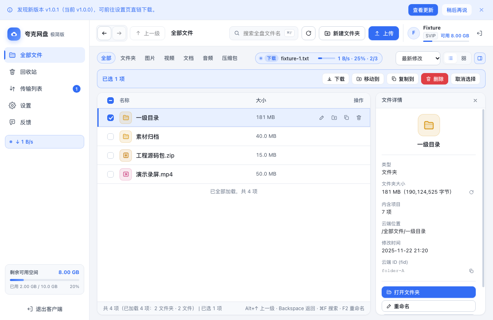

<div align="center">


# 夸克网盘极简版 · Quark Drive Lite

**轻巧、纯粹、高速的开源夸克网盘桌面客户端**  
基于 **Tauri 2 + Rust** 原生内核打造 · 使用原生 WebView · 零广告 · 零后台常驻 · 隐私优先

[](https://github.com/xiaodianshiuwu/quark-drive-lite/releases/latest)
[](https://github.com/xiaodianshiuwu/quark-drive-lite/releases/latest)
[](#核心架构与隐私承诺)
[](#核心架构与隐私承诺)
[](LICENSE)

[**立即下载 v1.0.0**](https://github.com/xiaodianshiuwu/quark-drive-lite/releases/latest) · [**30 秒上手**](#-30-秒快速上手) · [**界面预览**](#-界面预览) · [**完整更新日志**](CHANGELOG.md) · [**反馈问题**](https://github.com/xiaodianshiuwu/quark-drive-lite/issues)

</div>

---

> ### 致谢 · V1.0.0 正式版发布
> 非常感谢每一位给本项目点亮 **Star**、参与内测以及在 Issues 中提出宝贵建议的朋友！  
> 你们反馈的「深层目录返回上一级」「剩余空间直显」「灵活下载目录」「文件夹真实大小」「云解压」等痛点，正是推动 **V1.0.0 正式版** 从轻量原型一步步打磨成熟的动力。

---

## ✨ 为什么选择极简版？

官方客户端体积动辄数百 MB、常驻多进程与推广入口；**夸克网盘极简版**专注于把网盘最核心、最高频的体验做到极致流畅：

| 维度 | 夸克网盘极简版 v1.0.0 |
|---|---|
| **体积与性能** | **Tauri 2 + Rust 原生内核**，使用原生 WebView，启动快、低内存占用、无多余后台驻留 |
| **高效浏览体验** | 深层目录面包屑（`···` 一键直达上级 + 滚轮/箭头滚动）、**文件夹真实大小自动回填**、分类快筛、列表/网格切换、大目录虚拟滚动 |
| **自研高速传输** | Rust 事件驱动多线程分片下载与并发分片上传、断点续传、SHA-1/MD5 校验、**支持每文件自定义保存位置**、并发数不设硬上限 |
| **五大极简云工具** | **压缩包云解压与在线浏览**（目录钻取 / 密码解锁 / 勾选解压 / 同名覆盖）、**增强文件详情 & 历史版本恢复**、**空间占用分类明细**、**轻量回收站** |
| **隐私与可控** | Cookie 本地 AES-256-GCM 加密、直连夸克官方接口；可选作者更新/反馈通道**默认关闭且底层零外传**，AI 实验室默认关闭 |

---

## 📸 界面预览

### 浅色 / 深色双主题 · 文件夹真实大小自动统计 + 详情侧栏 + 实时传输胶囊

<table>
  <tr>
    <td width="50%">
      
      <div align="center"><sub>浅色工作台 · 文件夹真实大小自动回填 & 右侧增强详情</sub></div>
    </td>
    <td width="50%">
      
      <div align="center"><sub>深色工作台 · 实时传输胶囊 & 顶部/侧栏剩余空间直显</sub></div>
    </td>
  </tr>
</table>

### 极简云工具 · 云解压 / 空间占用明细 / 回收站 / 首次引导教程

<table>
  <tr>
    <td width="50%">
      
      <div align="center"><sub>压缩包云解压 · 目录钻取 / 密码解锁 / 勾选解压 / 同名覆盖</sub></div>
    </td>
    <td width="50%">
      
      <div align="center"><sub>空间占用明细 · 点击左下角空间卡片一键查看分类占比</sub></div>
    </td>
  </tr>
  <tr>
    <td width="50%">
      
      <div align="center"><sub>轻量回收站 · 原路径与剩余保留天数一目了然</sub></div>
    </td>
    <td width="50%">
      
      <div align="center"><sub>新手引导教程 · 4 步快速上手，支持随时「全部跳过」</sub></div>
    </td>
  </tr>
</table>

---

## 🚀 30 秒快速上手

### 1. 下载安装

前往 [**GitHub Releases（v1.0.0 正式版）**](https://github.com/xiaodianshiuwu/quark-drive-lite/releases/latest) 选择对应平台：

| 平台 | 推荐安装包 | 说明 |
|---|---|---|
| **Windows 10 / 11 (x64)** | `QuarkDriveLite-1.0.0-Windows-x64-setup.exe` | 标准安装版（支持简中/英文、当前用户免管理员安装、干净卸载零残留） |
| **Windows 10 / 11 (x64)** | `QuarkDriveLite-1.0.0-Windows-x64-portable.zip` | 绿色便携版（解压即用，支持中文与含空格路径，无需安装） |
| **macOS Apple Silicon (M1–M4)** | `QuarkDriveLite-1.0.0-macOS-arm64.zip` | 解压后将 `夸克网盘极简版.app` 拖入「应用程序」即可 |
| **macOS Intel (x64)** | `QuarkDriveLite-1.0.0-macOS-x64.zip` | 解压后将 `夸克网盘极简版.app` 拖入「应用程序」即可 |
| **Linux x64（Ubuntu / Debian 系）** | `QuarkDriveLite-1.0.0-Linux-x64.deb` | 运行 `sudo apt install ./QuarkDriveLite-1.0.0-Linux-x64.deb`，再从应用菜单打开 Quark Drive Lite |
| **Linux x64（便携版）** | `QuarkDriveLite-1.0.0-Linux-x64.AppImage` | 运行 `chmod +x QuarkDriveLite-1.0.0-Linux-x64.AppImage`，再双击或用终端启动 |

Linux 和 macOS Intel 安装包从 GitHub Releases 下载。Linux 的系统要求以及 AppImage 的运行方式见[平台支持](docs/PLATFORM_SUPPORT.md)。

> 💡 **提示**：Linux 和 macOS Intel 包使用 `SHA256SUMS-Additional.txt` 校验，首发包使用 `SHA256SUMS.txt`；若 macOS 首次打开提示「无法验证开发者」，可在终端执行 `xattr -dr com.apple.quarantine "/Applications/夸克网盘极简版.app"` 后打开。

### 2. 三步开始使用

1. **查看或跳过新手引导**：首次启动会自动展示 4 步精简教程，随时可点左下角「全部跳过」，以后也能在 `设置 → 查看使用教程` 随时重看。
2. **扫码登录夸克账号**：点击右上角「登录」，在独立原生窗口完成夸克扫码/账号登录（凭证自动加密存于本机）。
3. **高效管理与高速传输**：
   - **双击**文件夹进入、**双击**文件直接下载，或**右键**文件选择「下载到指定位置…」「云解压 / 浏览内容…」；
   - **拖拽**本地文件到窗口即可直接上传到当前目录；
   - 点击左下角**剩余可用空间**卡片即可查看各来源占用明细并直达回收站清理空间。

---

## ⌨️ 常用快捷键

| 快捷键 | 功能 |
|---|---|
| `Alt + ↑` / `Backspace` | 返回上一级目录（或退出搜索返回原目录） |
| `Alt + ←` / `Alt + →` / 鼠标侧键 | 目录浏览历史后退 / 前进 |
| `Ctrl + F`（macOS: `⌘ + F`） | 聚焦全盘文件搜索 |
| `F2` | 重命名当前选中文件/文件夹 |
| `Enter` | 打开选中文件夹 / 下载选中文件 |
| `Ctrl + A`（macOS: `⌘ + A`） | 全选当前列表 |
| `Delete`（macOS: `⌘ + Backspace`） | 删除选中项目至回收站 |
| `F5` / `Ctrl + R`（`⌘ + R`） | 刷新当前目录与剩余空间 |

---

## 🛡️ 核心架构与隐私承诺

- **本地加密与直连官方**：登录 Cookie 采用 **QCK2 AES-256-GCM** 加密存储于本机独立资料目录（不注入前端页面），所有网盘操作均由 Rust 核心直接请求夸克官方 HTTPS 接口，无中间代理、不绕过官方权益校验。
- **可选的作者更新与反馈通道（默认关闭）**：
  - 首次启动可自主决定是否开启；**选择「暂不开启」后，Rust 底层硬拦截一切请求，严格零外传。**
  - 开启后支持：① 接收最新更新日志并直链下载经 **Ed25519 数字签名 + SHA-256** 双重校验的安装包；② 在侧栏「反馈」直接向作者反馈问题（可先预览脱敏日志再提交）；③ 上传严格脱敏的非敏感性能/错误码摘要（绝不含文件名、本地路径、Cookie、账号或任何隐私）。
  - 全链路采用 **HTTPS TLS 1.3 + X25519 / AES-256-GCM** 端到端加密（服务端位于海外东京节点，如遇直连波动可开代理重试，不开启完全不影响本地网盘使用）。
- **AI 实验室（Beta · 默认关闭）**：内置对话与 MCP / Agent 网关默认完全隐藏且不启动，有需要可在 `设置 → AI 实验室` 手动开启，外部 Agent 默认只读并支持细粒度目录白名单。
- **独立资料目录**：
  - macOS：`~/Library/Application Support/cn.quarkdrive.lite.tauri`
  - Windows：`%APPDATA%\cn.quarkdrive.lite.tauri`
  - Linux：`$XDG_DATA_HOME/cn.quarkdrive.lite.tauri`（默认 `~/.local/share/cn.quarkdrive.lite.tauri`）

---

## 🛠️ 从源码构建与验证

需要 **Rust stable**、**Node.js ≥ 24** 及对应平台的 [Tauri 2 构建依赖](https://v2.tauri.app/start/prerequisites/)：

```sh
git clone https://github.com/xiaodianshiuwu/quark-drive-lite.git
cd quark-drive-lite
npm ci --ignore-scripts
npm start
```

常用命令：

```sh
npm run check          # JS 语法 / JSON 配置 + Rust workspace 静态检查
npm run test:rust      # Rust 全工作区单元测试（core / transfer / agent / tauri）
npm test               # 前端契约、AI 门控与无头 Chrome 全量 DOM 测试（66 项）
npm run verify:native  # 原生 WebView 端到端冒烟验证（29 项）
npm run verify:all     # 一键执行全部验证
npm run build          # 构建当前平台正式安装包
```

---

## 📚 进阶文档

- [完整更新日志（CHANGELOG.md）](CHANGELOG.md)
- [夸克接口取证与实测笔记（docs/API_NOTES.md）](docs/API_NOTES.md)
- [Tauri 2 + Rust 架构说明（docs/TAURI_ARCHITECTURE.md）](docs/TAURI_ARCHITECTURE.md)
- [渲染层桥接契约（docs/IPC_CONTRACT.md）](docs/IPC_CONTRACT.md)
- [Windows 实机验收清单（docs/WINDOWS_QA_CHECKLIST.md）](docs/WINDOWS_QA_CHECKLIST.md)

---

## 📄 开源许可

本项目以 [MIT License](LICENSE) 开源。若觉得好用，欢迎点一个 **Star ⭐** 支持！
