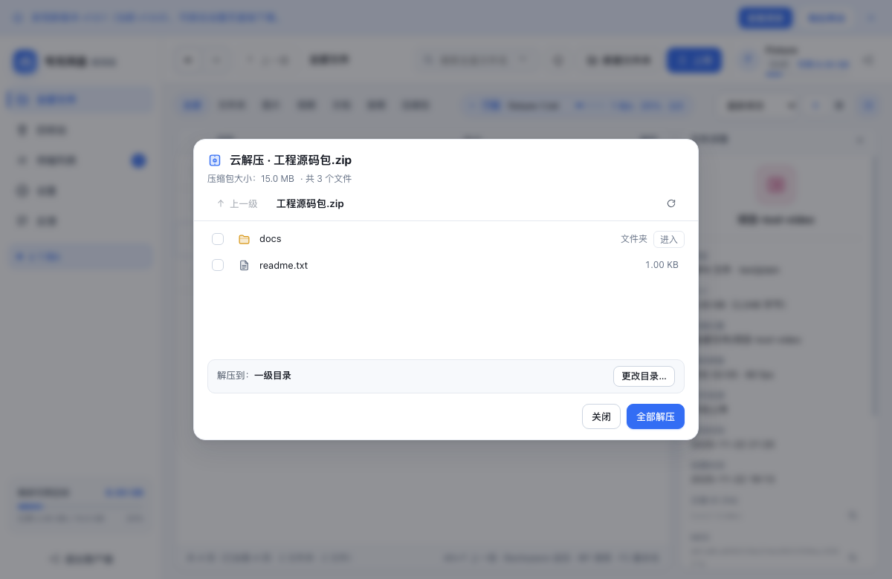

<div align="center">


# 夸克网盘极简版 · Quark Drive Lite

**轻巧、纯粹、高速的开源夸克网盘桌面客户端**  
基于 **Tauri 2 + Rust** 原生内核打造 · 4–6 MB 轻量体积 · 零广告 · 零后台常驻 · 隐私优先

[](https://github.com/xiaodianshiuwu/quark-drive-lite/releases/latest)
[](https://github.com/xiaodianshiuwu/quark-drive-lite/releases/latest)
[](#核心架构与隐私承诺)
[](#核心架构与隐私承诺)
[](LICENSE)

[**立即下载 v1.2.0**](https://github.com/xiaodianshiuwu/quark-drive-lite/releases/latest) · [**30 秒上手**](#-30-秒快速上手) · [**界面预览**](#-界面预览) · [**完整更新日志**](CHANGELOG.md) · [**反馈问题**](https://github.com/xiaodianshiuwu/quark-drive-lite/issues)

</div>

---

> ### 🎉 v1.2.0 正式发布 · 致谢每一位反馈者
> 非常感谢大家点亮 **Star**、在 [Issues](https://github.com/xiaodianshiuwu/quark-drive-lite/issues) 以及应用内「意见反馈」提交的每一条真实痛点！  
> 从深层目录返回上级、文件夹删除即时刷新、目录递归批量下载、应用内反馈进度与双向回复，到本次 **v1.2.0 彻底重构底部悬浮批量操作条（0px 列表位移，双击秒开）**、全量代码审计修复与自研 Rust 传输引擎深度提速，每一版都在把桌面网盘最核心的日常体验打磨得更顺手。

---

## ✨ 核心特性一览

官方客户端体积庞大、常驻多进程与广告推广；**夸克网盘极简版**用原生 Rust 内核专注做好文件浏览、高速并发传输与高频云工具：

| 维度 | 夸克网盘极简版 v1.2.0 |
|---|---|
| **原生轻量架构** | **Tauri 2 + Rust** 原生编译，Windows / macOS 安装包仅 **~4–6 MB**，复用系统 WebView，启动快、低内存、退出即彻底清理无后台驻留 |
| **丝滑文件浏览** | **底部悬浮批量操作胶囊（选行 0px 位移，双击文件夹/文件百发百中）**、深层目录面包屑（`···` 一键跳级 + 滚轮/侧键历史前进后退）、**文件夹真实大小自动回填**、分类快筛、列表/网格双视图虚拟滚动 |
| **自研高速传输引擎** | Rust 异步多线程分片下载（1 MiB 写缓冲 + 大文件 8/16 MiB 自适应分片 + 403 单飞刷新 + 429 退避）、流式并发分片上传（复用哈希免重复读盘 + 秒传 + 实时进度）、**支持整个文件夹及子目录递归批量下载**、断点续传、每文件可选保存位置、跨文件系统（NTFS/APFS/exFAT/SMB）安全落盘 |
| **五大极简云工具** | **压缩包云解压与在线浏览**（目录钻取 / 密码解锁 / 勾选部分解压 / 同名覆盖确认）、**增强文件详情 & 历史版本恢复**、**云盘空间占用分类明细**、**轻量回收站**、**实时状态栏与顶栏剩余空间直显** |
| **应用内更新与双向反馈** | 可选开启更新与反馈通道（**默认关闭、拒绝即底层零外传**）：支持 **Ed25519 数字签名 + SHA-256** 校验直链更新（启动及每 15 分钟自动静默检查）、应用内提交反馈并追踪处理进度与**作者双向回复对话** |

---

## 📸 界面预览

### 浅色 / 深色双主题 · 文件夹真实大小自动统计 + 详情侧栏 + 实时传输胶囊

<table>
  <tr>
    <td width="50%">
      
      <div align="center"><sub>浅色工作台 · 文件夹真实大小自动回填 & 右侧增强详情</sub></div>
    </td>
    <td width="50%">
      
      <div align="center"><sub>深色工作台 · 实时传输胶囊 & 顶部/侧栏剩余空间直显</sub></div>
    </td>
  </tr>
</table>

### 极简云工具 · 云解压 / 空间占用明细 / 回收站 / 首次引导教程

<table>
  <tr>
    <td width="50%">
      
      <div align="center"><sub>压缩包云解压 · 目录钻取 / 密码解锁 / 勾选解压 / 同名覆盖</sub></div>
    </td>
    <td width="50%">
      
      <div align="center"><sub>空间占用明细 · 点击左下角空间卡片一键查看分类占比</sub></div>
    </td>
  </tr>
  <tr>
    <td width="50%">
      
      <div align="center"><sub>轻量回收站 · 原路径与剩余保留天数一目了然</sub></div>
    </td>
    <td width="50%">
      
      <div align="center"><sub>新手引导教程 · 4 步快速上手，支持随时「全部跳过」</sub></div>
    </td>
  </tr>
</table>

---

## 🚀 30 秒快速上手

### 1. 下载安装（全平台覆盖）

前往 [**GitHub Releases（v1.2.0 最新版）**](https://github.com/xiaodianshiuwu/quark-drive-lite/releases/latest) 选择对应系统（已开启应用内更新的用户可直接一键直链升级）：

| 平台 | 安装包文件 | 说明 |
|---|---|---|
| **Windows 10 / 11 (x64)** | `QuarkDriveLite-1.2.0-Windows-x64-Setup.exe` | **安装版**（支持简中/英文、当前用户免管理员安装、支持干净卸载） |
| **Windows 10 / 11 (x64)** | `QuarkDriveLite-1.2.0-Windows-x64-Portable.zip` | **便携版**（UTF-8 编码兼容，解压即运行） |
| **macOS Apple Silicon (arm64)** | `QuarkDriveLite-1.2.0-macOS-arm64.dmg` / `.zip` | M系列 Mac，拖入「应用程序」即可使用 |
| **macOS Intel (x64)** | `QuarkDriveLite-1.2.0-macOS-x64.zip` | Intel 芯片 Mac，解压后拖入「应用程序」即可使用 |
| **Linux x64（Debian / Ubuntu）** | `QuarkDriveLite-1.2.0-Linux-x64.deb` | 运行 `sudo apt install ./QuarkDriveLite-1.2.0-Linux-x64.deb` 安装 |
| **Linux x64（通用便携版）** | `QuarkDriveLite-1.2.0-Linux-x64.AppImage` | 运行 `chmod +x QuarkDriveLite-1.2.0-Linux-x64.AppImage` 后直接运行 |

> 💡 **校验与 macOS 首次启动提示**：
> - 所有发行包均提供 `SHA256SUMS.txt` 校验文件；应用内直链下载自动验证 **Ed25519 签名 + SHA-256**。
> - Linux 依赖说明见 [平台支持文档](docs/PLATFORM_SUPPORT.md)。
> - 若 macOS 首次打开提示「无法验证开发者」（未签名开源构建），在终端执行一次：
>   ```sh
>   xattr -dr com.apple.quarantine "/Applications/夸克网盘极简版.app"
>   ```

### 2. 三步开始使用

1. **查看或跳过新手引导**：首次启动展示 4 步精简教程，可随时一键「全部跳过」，后续可在 `设置 → 查看使用教程` 重看。
2. **登录夸克账号**：点击右上角「登录」，在独立原生窗口完成扫码或账号登录（凭证自动加密存于本机）。
3. **日常高效操作**：
   - **双击**文件夹秒进、**双击**文件直接下载，**右键**支持「下载到指定位置…」「下载文件夹」「云解压 / 浏览内容…」；
   - **拖拽**本地文件到窗口直接上传至当前目录；
   - 点击左下角**剩余可用空间**卡片查看分类明细，并可直达回收站清理空间；
   - 开启可选更新与反馈通道后，可在左侧「反馈」提交问题、查看处理进度并与作者直接对话。

---

## ⌨️ 常用快捷键

| 快捷键 | 功能 |
|---|---|
| `Alt + ↑` / `Backspace` | 返回上一级目录（或退出搜索返回原目录） |
| `Alt + ←` / `Alt + →` / 鼠标侧键 | 目录浏览历史后退 / 前进 |
| `Ctrl + F`（macOS: `⌘ + F`） | 聚焦全盘文件搜索 |
| `Ctrl + I`（macOS: `⌘ + I`） | 开关右侧文件详情抽屉 |
| `Ctrl + Shift + N`（macOS: `⌘ + ⇧ + N`） | 在当前目录新建文件夹 |
| `F2` | 重命名当前选中文件/文件夹 |
| `Enter` | 打开选中文件夹 / 下载选中文件 |
| `Ctrl + A`（macOS: `⌘ + A`） | 全选当前列表 |
| `Esc` | 取消当前选中 / 关闭弹窗 |
| `Delete`（macOS: `⌘ + Backspace`） | 删除选中项目至回收站 |
| `F5` / `Ctrl + R`（`⌘ + R`） | 刷新当前目录与剩余空间 |

---

## 🛡️ 核心架构与隐私承诺

- **本地加密、直连夸克官方接口**：登录 Cookie 使用 **QCK2 AES-256-GCM** 加密保存于本机独立资料目录（不注入前端页面），所有网盘请求均由 Rust 内核直连夸克官方 HTTPS 接口，无中转代理、不绕过官方权益规则。
- **可选的更新与反馈通道（默认关闭）**：
  - 首次启动弹窗征询同意；**选择「暂不开启」后，Rust 底层硬拦截一切相关网络请求，严格零外传。**
  - 开启后所有上报均走 **HTTPS TLS 1.3 + X25519 / AES-256-GCM 端到端加密**（已接入 Cloudflare 边缘代理），更新包下载校验 **Ed25519 数字签名 + SHA-256**。
  - **严格零 PII 脱敏原则**：传输性能样本仅采集纯数值指标（速率、耗时、文件大小区间、分片/并发参数、策略、错误码），**绝不采集任何文件名、本地路径、FID、直链、Cookie、Token、账号或 IP**；用户主动附带的反馈日志也会在加密前经过客户端严格脱敏并支持提交前全文预览。
- **AI 实验室（Beta · 默认关闭）**：内置对话与 MCP / Agent 本地网关默认隐藏且不启动，需在 `设置 → AI 实验室` 手动开启，默认只读且严格受目录白名单约束。
- **独立资料目录**：
  - macOS：`~/Library/Application Support/cn.quarkdrive.lite.tauri`
  - Windows：`%APPDATA%\cn.quarkdrive.lite.tauri`
  - Linux：`$XDG_DATA_HOME/cn.quarkdrive.lite.tauri`（默认 `~/.local/share/cn.quarkdrive.lite.tauri`）

---

## 🛠️ 从源码构建与自动化验证

环境要求：**Rust stable**、**Node.js ≥ 24** 及对应平台的 [Tauri 2 构建依赖](https://v2.tauri.app/start/prerequisites/)：

```sh
git clone https://github.com/xiaodianshiuwu/quark-drive-lite.git
cd quark-drive-lite
npm ci --ignore-scripts
npm start
```

常用开发与验证命令：

```sh
npm run check          # JS 语法 / JSON 配置 + Rust workspace 静态检查
npm run test:rust      # Rust 全工作区单测与跨语言 E2EE 集成测试（163 项）
npm test               # 前端契约、AI 门控与无头 Chrome 全量 DOM 回归（67 项）
npm run verify:native  # 原生 WebView 端到端冒烟验证（29 项）
npm run verify:all     # 一键执行全链路验证
npm run build          # 构建当前平台正式安装包
```

---

## 📚 进阶文档

- [完整更新日志（CHANGELOG.md）](CHANGELOG.md)
- [平台支持与 Linux 运行指南（docs/PLATFORM_SUPPORT.md）](docs/PLATFORM_SUPPORT.md)
- [夸克接口取证与实测笔记（docs/API_NOTES.md）](docs/API_NOTES.md)
- [Tauri 2 + Rust 架构说明（docs/TAURI_ARCHITECTURE.md）](docs/TAURI_ARCHITECTURE.md)
- [渲染层桥接契约（docs/IPC_CONTRACT.md）](docs/IPC_CONTRACT.md)
- [Windows 实机验收清单（docs/WINDOWS_QA_CHECKLIST.md）](docs/WINDOWS_QA_CHECKLIST.md)

---

## 📄 开源许可

本项目基于 [MIT License](LICENSE) 开源。如果觉得轻量顺手，欢迎点一个 **Star ⭐** 支持！
